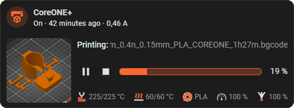
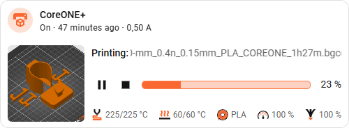

# PrusaLink Card for Home Assistant <!-- omit from toc -->

[](https://github.com/hondzik/prusalink-card/releases)
[](LICENSE)
[](https://github.com/hondzik)
[](https://github.com/hondzik/prusalink-card/commits/main)

A Lovelace card that shows a 3D printer exposed by the [PrusaLink integration](https://www.home-assistant.io/integrations/prusalink/): the print preview, status, controls, progress, temperatures and the loaded filament in the space of a single Tile card. Optionally a Tile-like block for the remotely switched socket that powers the printer is added above it. The printer block is two grid rows high, the socket block adds one more.

 


## Table of contents <!-- omit from toc -->

- [Requirements](#requirements)
- [Installation](#installation)
- [Adding the card](#adding-the-card)
- [How it works](#how-it-works)
  - [Socket block](#socket-block)
  - [Printer block](#printer-block)
  - [Picture of the printer instead of the socket icon](#picture-of-the-printer-instead-of-the-socket-icon)
  - [Switching the socket off safely](#switching-the-socket-off-safely)
- [Configuration options](#configuration-options)
- [Troubleshooting](#troubleshooting)
- [Translations](#translations)
- [License](#license)
  - [Icons](#icons)

## Requirements

- The [PrusaLink integration](https://www.home-assistant.io/integrations/prusalink/) set up and working for your printer.
- Optionally a `switch` entity of the socket powering the printer.

## Installation

Install through [HACS](https://hacs.xyz/) as a custom repository (category: plugin) using the badge below.

[](https://my.home-assistant.io/redirect/hacs_repository/?repository=prusalink-card&owner=hondzik&category=Plugin)

## Adding the card

Pick **PrusaLink printer** in the card picker, or select any entity of the printer in the "add card" dialog — the card is suggested for every entity of the `prusalink` integration.

```yaml
type: custom:prusalink-card
entity: sensor.prusa_core_one
switch_entity: switch.printer_socket
progress_text: time_remaining
```

## How it works

The card takes the device of the selected `entity` and finds all its sibling entities by their `entity_id` suffix (`nozzle_temperature`, `progress`, `preview`, ...). A second config entry of the same printer, whose entities end with `_2`, works the same way.

### Socket block

Shown only when `switch_entity` is set. It copies the Tile card: the icon (changeable with `icon`) toggles the socket and is Prusa orange while the socket is on, the name and the secondary information (`state_content`) work like in the Tile card (which can only show attributes of the socket itself, so `secondary_entities` adds states of other entities, e.g. the power draw), tapping the text opens the more-info dialog. **Turning the socket off always asks for confirmation.**

### Printer block

Two columns:

- **Preview** — the image of the `camera.*_preview*` entity of the printer. Clicking it opens a larger preview in a dialog.
- **Details** in three rows:
  - the printer state, followed by `: <file name>` while a job is running (a name that does not fit slowly scrolls back and forth),
  - pause-resume / cancel buttons, a progress bar and a value at its end (see `progress_text`),
  - nozzle and heatbed temperature (`current/target`), the loaded filament, and the print speed and flow rate.

The first button is pause while printing and resume while paused; it uses the printer's `resume` or `continue` button, whichever is currently available. When nothing is running it stays visible as a disabled play/pause icon. The second button cancels the print. Buttons that the printer cannot accept right now are disabled. Cancelling a print asks for confirmation.

### Picture of the printer instead of the socket icon

In the visual editor, choose **Socket picture**: Home Assistant's media browser opens, where you can upload a picture, pick it, or delete uploaded pictures. The pictures are stored in your Home Assistant **media** folder (`/media`, shown as "My media"), the card only keeps a link such as `media-source://media_source/local/printer.png` and resolves it to a temporary URL (refreshed every few hours). Switch **Use the picture** off (`use_image: false`) to get the icon back without losing the chosen picture. In YAML you can also give a plain URL, e.g. `image: /local/printer.png`.

### Switching the socket off safely

Clicking the socket icon or name switches the socket on, or asks for confirmation before switching it off. The socket can only be switched off while the printer does nothing (`idle`, `ready`, `finished`, `stopped`, or it does not answer at all) and the nozzle is below 40 °C; otherwise a dialog explains why not.

The dialog can also offer **Switch off when possible**: Home Assistant itself then switches the socket off as soon as the printer allows it, even when no dashboard is open. The icon pulses while it waits; clicking the icon or name cancels the waiting. This needs a helper and an automation, which the visual editor creates for you: with a socket selected, an administrator sees the button **Create helper and automation**. It creates an `input_boolean` helper (stored as `pending_off_entity`) and the automation `prusalink_card_switch_off_<socket>`; clicking it again only rewrites the automation. Neither is deleted with the card, remove them in *Settings → Devices & services → Helpers / Automations* when you no longer need them.

> **Use at your own risk.** The card and the automation cut the power to a machine that melts plastic at 200+ °C, based on a state that a printer, a network and a Home Assistant restart may report wrongly or late. They try hard not to pull the plug in the middle of a print, but no guarantee is given: a socket switched off a moment too early, a print that ended up as a very expensive spaghetti monster, or a nozzle that cooled down in the wrong place are all on you. I take no responsibility for ruined prints, wasted filament, hurt feelings or a printer that sulks afterwards. If a print really matters, do not rely on a blind "switch off when possible" — keep an eye on it. 🍝

## Configuration options

| Option | Type | Default | Description |
| ------ | ---- | ------- | ----------- |
| `entity` | `string` | required | Any entity of the PrusaLink printer. |
| `switch_entity` | `string` | none | Socket powering the printer; adds the Tile block. |
| `icon` | `string` | state icon | Icon of the socket in the Tile block, e.g. `mdi:printer-3d`. |
| `image` | media | none | Picture of the printer shown instead of the socket icon (see below). |
| `use_image` | `boolean` | `true` | Set to `false` to show the icon again while keeping the chosen picture. |
| `pending_off_entity` | `string` | none | `input_boolean` behind "Switch off when possible" (see below). |
| `name` | `string` | entity name | Name of the socket in the Tile block. |
| `secondary_entities` | `string[]` | none | Further entities (e.g. the socket's power sensor) of the selected printer or socket whose states are appended to the secondary information, separated by `·`. |
| `state_content` | `string[]` | `state`, `last-changed` | Secondary information of the Tile block, as in the Tile card. |
| `show_speed` | `boolean` | `true` | Show the print speed in the bottom row. |
| `show_flow` | `boolean` | `true` | Show the flow rate in the bottom row. |
| `progress_text` | `string` | `percent_done` | Value at the end of the progress bar: `percent_done`, `percent_remaining`, `time_remaining` or `finish_time`. |

All options are available in the visual editor.

## Troubleshooting

- **"No PrusaLink printer found"** — the selected entity is not part of a PrusaLink device, or the printer's main sensor is missing. Pick an entity of the integration.
- **No preview** — the card needs a `camera` entity whose id contains `_preview`; the PrusaLink integration creates it only while it has an image.
- **Open the browser console** to see the card's version and verify the right bundle is loaded.

## Translations

The editor and the card are translated into cs, de, en, es, fr, he, hu, it, ja, nl, no, pl, pt, sk, sv, uk and zh; the language follows your Home Assistant profile and falls back to English.

## License

Copyright (C) 2026 hondzik. This project is licensed under the [GNU General Public License v3.0](LICENSE) (`GPL-3.0-only`).

The card bundles icons from a GPL-3.0 project (see below), and the build inlines them into `dist/prusalink-card.js`, so the distributed bundle as a whole has to be GPL-3.0 as well. That is why the whole project is GPL-3.0 rather than a more permissive license. The GPL-3.0 is compatible with the MIT-licensed code this project was started from.

### Icons

The icons in `src/assets/icons/` are taken unmodified from [Prusa-Link-Web](https://github.com/prusa3d/Prusa-Link-Web/tree/master/src/assets) by Prusa Research, which is licensed under the GPL-3.0:

| File | Used for |
| ---- | -------- |
| `status_nozzle.svg` | Nozzle temperature |
| `status_heatbed.svg` | Heatbed temperature |
| `status_filament.svg` | Loaded filament |
| `status_prnspeed.svg` | Print speed |
| `status_prnflow.svg` | Flow rate |

The only processing is done at build time (`scripts/optimize-icons.mjs`): the SVGs are minified with SVGO and their fixed `width`/`height` are dropped so the card can size them. The orange parts keep their color, the white parts are replaced by `currentColor`, so they follow the text color of your theme (dark on a light background, light on a dark one).

This project is not affiliated with or endorsed by Prusa Research. "Prusa" and "PrusaLink" are trademarks of their respective owner.
